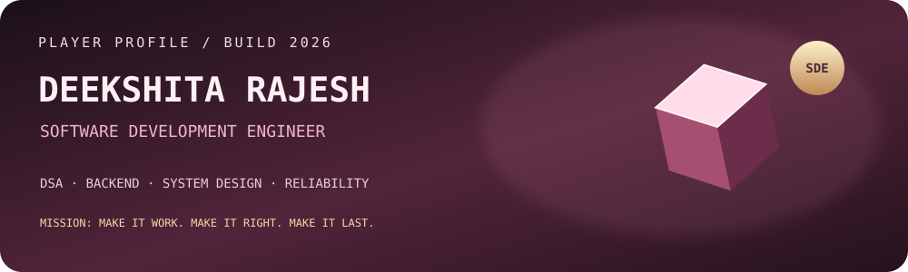
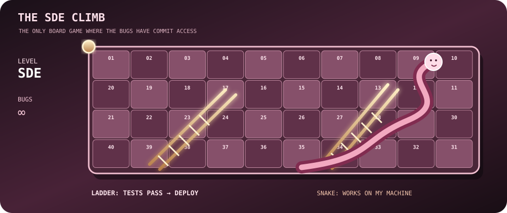
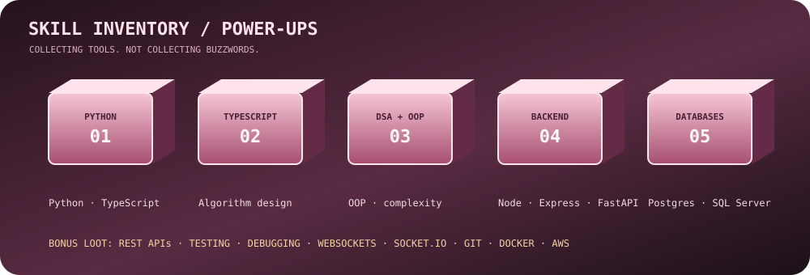
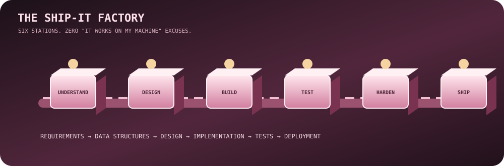
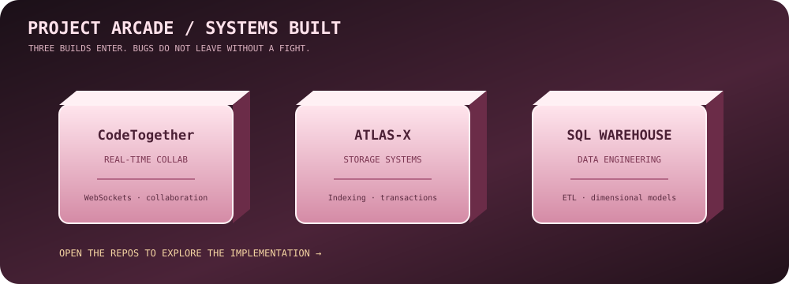
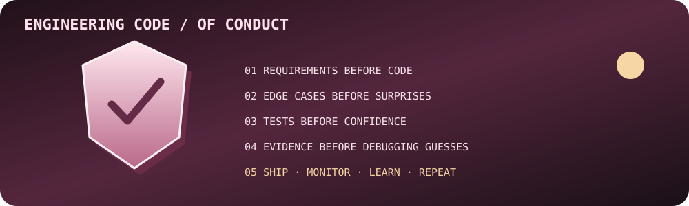

 

 

---

---

<strong>🪜 CLIMB:</strong> DSA → OOP → DESIGN → BUILD → TEST → SHIP

<strong>🐍 SLIDE:</strong> NULL POINTERS · RACE CONDITIONS · "WORKS ON MY MACHINE" · FRIDAY DEPLOYS

Roll the dice. The bug rolls back.

---

<table>
<tr>
<td width="50%" valign="top">

**PROGRAMMING**

Python · TypeScript

**COMPUTER SCIENCE**

Data Structures & Algorithms · Algorithm Design · OOP · Object-Oriented Design · Problem Solving · Time & Space Complexity

**SOFTWARE ENGINEERING**

SDLC · Software Design · Design Patterns · Distributed Systems · RESTful APIs · Testing · Debugging · Code Quality

</td>
<td width="50%" valign="top">

**BACKEND & DATABASES**

Node.js · Express.js · FastAPI · PostgreSQL · SQL Server · SQL · Relational Database Design · Database Indexing

**SYSTEMS & TOOLS**

WebSockets · Socket.IO · Git · Docker · AWS

</td>
</tr>
</table>

---

---

<table>
<tr>
<td width="33%" align="center">

**[CodeTogether](https://github.com/deekshitaa1/CodeTogether)**

Real-time collaborative coding

</td>
<td width="33%" align="center">

**[ATLAS-X](https://github.com/deekshitaa1/ATLAS-X)**

Storage engine & systems research

</td>
<td width="33%" align="center">

**[SQL Data Warehouse](https://github.com/deekshitaa1/sql-data-warehouse-project)**

ETL & dimensional modelling

</td>
</tr>
</table>

---

### BUILD WITH INTENT. TEST WITH EVIDENCE. SHIP WITH CONFIDENCE.

[LINKEDIN](https://www.linkedin.com/in/deekshita-rajesh) · [GITHUB](https://github.com/deekshitaa1) · [PORTFOLIO](https://deekshita-portfolio-one.vercel.app/)

01010011 01000100 01000101 · STILL DEBUGGING. STILL BUILDING.

