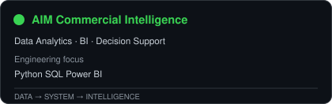
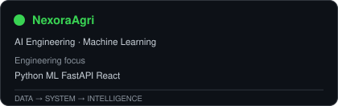
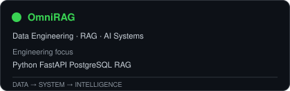
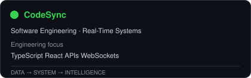
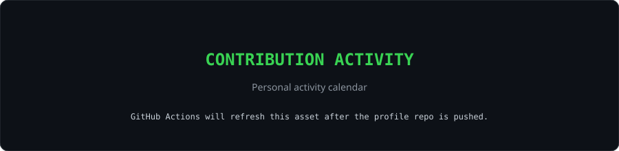
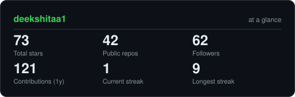
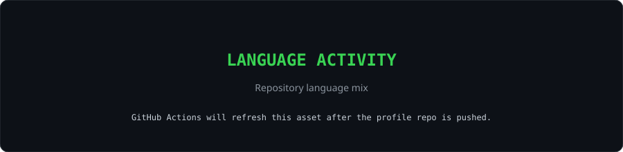
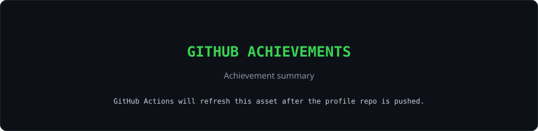

<div align="center">


<br>

<a href="https://github.com/deekshitaa1">
  
</a>

<br>

<a href="https://www.linkedin.com/in/deekshita-rajesh">
  
</a>
<a href="mailto:deekshitarajesh1@gmail.com">
  
</a>
<a href="https://deekshita-portfolio-one.vercel.app/">
  
</a>
<a href="https://leetcode.com/u/deekshiarajesh/">
  
</a>

</div>


</div>

---

## `~/` whoami

```console
$ whoami
Deekshita Rajesh

$ focus --current
Software Engineering

$ objective
Design, build, test, and deploy reliable, scalable, production-ready software.
```

I focus on **software development, backend engineering, data structures and algorithms, and system design**.
I enjoy turning requirements into maintainable applications through clean code, APIs, database design, testing, and deployment. I also apply data and AI where they strengthen the product.

> **Understand the problem. Build the solution. Test it. Ship it.**

---

<div align="center">

## `~/` toolbox


</div>

---


## `~/` capabilities

<table>
  <tr>
    <td width="33%" valign="top">
      <h3>SOFTWARE DEVELOPMENT</h3>
      <code>Data Structures & Algorithms</code> ·
      <code>Object-Oriented Programming</code><br>
      <code>Problem Solving</code> ·
      <code>System Design</code>
    </td>
    <td width="33%" valign="top">
      <h3>PROGRAMMING LANGUAGES</h3>
      <code>Python</code> · <code>Java</code> · <code>SQL</code>
    </td>
    <td width="33%" valign="top">
      <h3>BACKEND DEVELOPMENT</h3>
      <code>REST APIs</code> · <code>Microservices</code><br>
      <code>Spring Boot</code> · <code>Authentication</code><br>
      <code>Error Handling</code>
    </td>
  </tr>
  <tr>
    <td width="33%" valign="top">
      <h3>DATABASES</h3>
      <code>Amazon DynamoDB</code> · <code>PostgreSQL</code><br>
      <code>MySQL</code> · <code>Amazon RDS</code><br>
      <code>Amazon ElastiCache</code>
    </td>
    <td width="33%" valign="top">
      <h3>CLOUD & AWS</h3>
      <code>AWS</code> · <code>Amazon EC2</code><br>
      <code>Amazon S3</code> · <code>AWS Lambda</code><br>
      <code>Amazon SQS</code> · <code>Amazon SNS</code><br>
      <code>IAM</code> · <code>CloudWatch</code>
    </td>
    <td width="33%" valign="top">
      <h3>DEVELOPER TOOLS</h3>
      <code>Git</code> · <code>GitHub</code> · <code>Linux</code><br>
      <code>Docker</code> · <code>CI/CD</code><br>
      <code>Unit Testing</code>
    </td>
  </tr>
  <tr>
    <td colspan="3" valign="top">
      <h3>ENGINEERING FUNDAMENTALS</h3>
      <code>Operating Systems</code> · <code>Computer Networks</code> ·
      <code>DBMS</code> · <code>Concurrency</code> ·
      <code>Multithreading</code> · <code>Object-Oriented Design</code> ·
      <code>Scalability</code>
    </td>
  </tr>
</table>
---

<div align="center">


## `~/` skill radar

<table>
<tr>
<td width="50%" align="center" valign="middle">

<picture>
  <source media="(prefers-color-scheme: dark)" srcset="assets/radar-dark.svg">
  <source media="(prefers-color-scheme: light)" srcset="assets/radar-light.svg">
  
</picture>

</td>
<td width="50%" align="center" valign="middle">

<picture>
  <source media="(prefers-color-scheme: dark)" srcset="assets/radar-delivery-dark.svg">
  <source media="(prefers-color-scheme: light)" srcset="assets/radar-delivery-light.svg">
  
</picture>

</td>
</tr>
</table>

</div>

---

## `~/` engineering loop

```text
                         USER / BUSINESS REQUIREMENT
                                   │
                                   ▼
                          REQUIREMENTS + EDGE CASES
                                   │
                                   ▼
                          DATA STRUCTURES + DESIGN
                                   │
                                   ▼
                         IMPLEMENTATION + APIs
                                   │
                                   ▼
                           UNIT / INTEGRATION TESTS
                                   │
                                   ▼
                          CODE REVIEW + DEBUGGING
                                   │
                                   ▼
                            CI/CD + DEPLOYMENT
                                   │
                                   ▼
                         MONITOR + IMPROVE + SCALE
```

The goal is to build **maintainable, tested, and scalable software**—from clear requirements and sound design through deployment and iteration.

---

<div align="center">

## `~/` selected systems

<table>
<tr>
<td width="50%">
  <a href="https://github.com/deekshitaa1/AIM-Commercial-Intelligence">
    <picture><source media="(prefers-color-scheme: light)" srcset="assets/card-aim-light.svg"></picture>
  </a>
</td>
<td width="50%">
  <a href="https://github.com/deekshitaa1/NexoraAgri">
    <picture><source media="(prefers-color-scheme: light)" srcset="assets/card-nexora-light.svg"></picture>
  </a>
</td>
</tr>
<tr>
<td width="50%">
  <a href="https://github.com/deekshitaa1/OmniRAG">
    <picture><source media="(prefers-color-scheme: light)" srcset="assets/card-omnirag-light.svg"></picture>
  </a>
</td>
<td width="50%">
  <a href="https://github.com/deekshitaa1/CodeSync">
    <picture><source media="(prefers-color-scheme: light)" srcset="assets/card-codesync-light.svg"></picture>
  </a>
</td>
</tr>
</table>

</div>

| System | Role | Engineering focus |
|---|---|---|

| **[NexoraAgri](https://github.com/deekshitaa1/NexoraAgri)** | AI Engineering · ML | Data validation → temporal features → classification + regression → explainability → decision engine |
| **[OmniRAG](https://github.com/deekshitaa1/OmniRAG)** | AI Engineering · Data Engineering | Document ingestion → extraction → chunking → PostgreSQL → vector retrieval → RAG |
| **[CodeSync](https://github.com/deekshitaa1/CodeSync)** | Software Engineering | Frontend/backend integration → APIs → real-time collaboration → maintainable application architecture |


---

## `~/` code → deployment

```text
ENGINEERING REQUIREMENT
        ↓
PROBLEM DECOMPOSITION
        ↓
DATA STRUCTURES & ALGORITHMS
        ↓
DESIGN + ARCHITECTURE
        ↓
IMPLEMENTATION
        ↓
UNIT + INTEGRATION TESTING
        ↓
CODE REVIEW + DEBUGGING
        ↓
CI/CD + DEPLOYMENT
        ↓
MONITORING + OPTIMIZATION
        ↓
SCALABLE SOFTWARE
```

---

<div align="center">

## `~/` contribution activity



<br><br>

<picture>
  <source media="(prefers-color-scheme: dark)" srcset="https://raw.githubusercontent.com/deekshitaa1/deekshitaa1/output/snake-dark.svg">
  <source media="(prefers-color-scheme: light)" srcset="https://raw.githubusercontent.com/deekshitaa1/deekshitaa1/output/snake.svg">
  
</picture>

</div>

---

<div align="center">

## `~/` the numbers

<picture>
  <source media="(prefers-color-scheme: dark)" srcset="assets/card-stats-dark.svg">
  <source media="(prefers-color-scheme: light)" srcset="assets/card-stats-light.svg">
  
</picture>

<br>



<br><br>



</div>

---

## `~/` certifications & learning

`Google Data Analytics Professional Certificate` · `Microsoft AI Fundamentals (AI-900)` · `NPTEL Data Science for Engineers`

`DeepLearning.AI Neural Networks and Deep Learning` · `MongoDB Deploying GenAI Apps` · `Infosys Springboard Generative AI` · `ServiceNow Micro-Certification`

---

## `~/` engineering principles

```text
01  CLARIFY REQUIREMENTS AND EDGE CASES
02  CHOOSE APPROPRIATE DATA STRUCTURES
03  WRITE CLEAN, MAINTAINABLE CODE
04  DESIGN FOR FAILURE AND SCALABILITY
05  TEST EARLY; DEBUG SYSTEMATICALLY
06  REVIEW FOR CORRECTNESS AND READABILITY
07  AUTOMATE BUILDS, TESTS, AND DEPLOYMENTS
08  SHIP · MONITOR · IMPROVE · SCALE
```

---

<div align="center">

### SOFTWARE DEVELOPMENT · SYSTEM DESIGN · CLOUD

**Deekshita Rajesh**  

[LinkedIn](https://www.linkedin.com/in/deekshita-rajesh) · [GitHub](https://github.com/deekshitaa1) · [Portfolio](https://deekshitaa1.github.io/deekshita-portfolio/)

<sub>`01010011 01001111 01000110 01010100 01010111 01000001 01010010 01000101 00100000 01000101 01001110 01000111 01001001 01001110 01000101 01000101 01010010 01001001 01001110 01000111`</sub>


</div>
