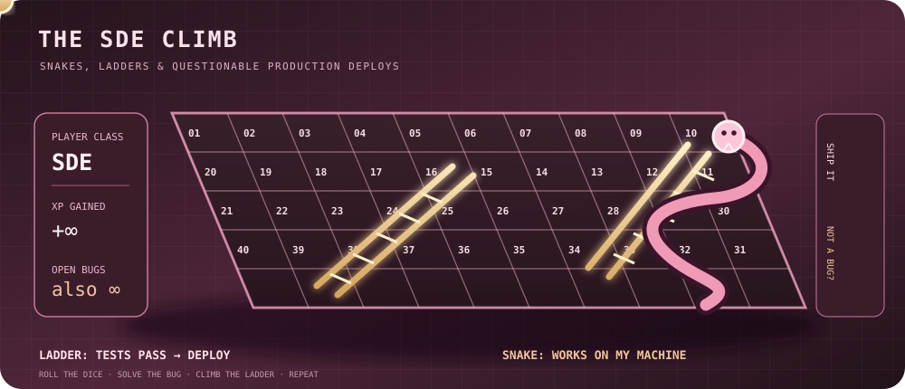

<div align="center">


<br>

<a href="https://github.com/deekshitaa1">
  
</a>

<br>

<a href="https://www.linkedin.com/in/deekshita-rajesh">
  
</a>
<a href="mailto:deekshitarajesh1@gmail.com">
  
</a>
<a href="https://deekshita-portfolio-one.vercel.app/">
  
</a>
<a href="https://leetcode.com/u/deekshiarajesh/">
  
</a>

</div>

---

## `~/` whoami

```console
$ whoami
Deekshita Rajesh

$ role --target
Software Development Engineer

$ engineering --focus
Data Structures & Algorithms · Backend Systems · API Design · System Design

$ mission
Turn complex problems into reliable, maintainable software.
```

I approach software engineering by understanding the problem first, choosing data structures deliberately, designing clear interfaces, and verifying behaviour beyond the happy path.

> **Write code that works. Engineer systems that keep working.**

---

## `~/` the SDE climb

<div align="center">
  
  <p><sub>ROLL THE DICE · SOLVE THE BUG · CLIMB THE LADDER · SHIP THE BUILD</sub></p>
</div>

<table>
  <tr>
    <td width="50%" valign="top">
      <h3>🪜 THE LADDER — LEVEL UP</h3>
      <p><code>DSA</code> → <code>OOP</code> → <code>System Design</code> → <code>Implementation</code> → <code>Testing</code> → <code>Deployment</code></p>
    </td>
    <td width="50%" valign="top">
      <h3>🐍 THE SNAKES — SCOPE CREEP IN DISGUISE</h3>
      <p><code>Off-by-one errors</code> · <code>Race conditions</code> · <code>Failed tests</code> · <code>Slow queries</code> · <code>Unexpected nulls</code></p>
    </td>
  </tr>
</table>

<p align="center"><sub>Every bug is a surprise interview question. The snake has requested a code review.</sub></p>

---

## `~/` technical skills

<table>
  <tr>
    <td width="50%" valign="top">
      <strong>PROGRAMMING LANGUAGES</strong><br><br>
      <code>Python</code> <code>TypeScript</code>
    </td>
    <td width="50%" valign="top">
      <strong>COMPUTER SCIENCE FUNDAMENTALS</strong><br><br>
      <code>Data Structures & Algorithms</code><br>
      <code>Algorithm Design</code><br>
      <code>Object-Oriented Programming</code><br>
      <code>Object-Oriented Design</code><br>
      <code>Problem Solving</code><br>
      <code>Time & Space Complexity Analysis</code>
    </td>
  </tr>
  <tr>
    <td width="50%" valign="top">
      <strong>SOFTWARE ENGINEERING</strong><br><br>
      <code>Software Development Life Cycle</code><br>
      <code>Software Design</code> · <code>Design Patterns</code><br>
      <code>Distributed Systems</code><br>
      <code>RESTful API Development</code><br>
      <code>Software Testing</code> · <code>Debugging</code><br>
      <code>Code Quality</code>
    </td>
    <td width="50%" valign="top">
      <strong>BACKEND & DATABASES</strong><br><br>
      <code>Node.js</code> · <code>Express.js</code> · <code>FastAPI</code><br>
      <code>PostgreSQL</code> · <code>SQL Server</code> · <code>SQL</code><br>
      <code>Relational Database Design</code><br>
      <code>Database Indexing</code>
    </td>
  </tr>
  <tr>
    <td colspan="2" valign="top">
      <strong>SYSTEMS & DEVELOPER TOOLS</strong><br><br>
      <code>WebSockets</code> · <code>Socket.IO</code> · <code>Git</code> · <code>Docker</code> · <code>AWS</code>
    </td>
  </tr>
</table>

---

## `~/` how I ship software

<table>
  <tr>
    <td align="center" width="33%"><sub>01</sub><br><strong>UNDERSTAND</strong><br>Requirements & edge cases</td>
    <td align="center" width="33%"><sub>02</sub><br><strong>DESIGN</strong><br>Data models & APIs</td>
    <td align="center" width="33%"><sub>03</sub><br><strong>BUILD</strong><br>Clean implementation</td>
  </tr>
  <tr>
    <td align="center"><sub>04</sub><br><strong>VERIFY</strong><br>Unit & integration tests</td>
    <td align="center"><sub>05</sub><br><strong>HARDEN</strong><br>Debugging & review</td>
    <td align="center"><sub>06</sub><br><strong>SHIP</strong><br>Deploy & monitor</td>
  </tr>
</table>

```text
REQUIREMENTS
    ↓
PROBLEM DECOMPOSITION
    ↓
DATA STRUCTURES + ALGORITHMS
    ↓
DESIGN + IMPLEMENTATION
    ↓
TEST + DEBUG + REVIEW
    ↓
DEPLOY + OBSERVE + IMPROVE
```

---

## `~/` selected systems

| PROJECT | ENGINEERING FOCUS |
|---|---|
| [CodeTogether](https://github.com/deekshitaa1/CodeTogether) | Real-time collaborative coding, backend integration and application architecture |
| [ATLAS-X](https://github.com/deekshitaa1/ATLAS-X) | Storage-engine concepts, indexing, transactions and distributed-storage research |
| [SQL Data Warehouse](https://github.com/deekshitaa1/sql-data-warehouse-project) | SQL engineering, ETL and dimensional data modelling |

---

## `~/` engineering principles

```text
01  CLARIFY REQUIREMENTS BEFORE IMPLEMENTING
02  REASON ABOUT EDGE CASES AND FAILURE MODES
03  CHOOSE DATA STRUCTURES DELIBERATELY
04  KEEP MODULES AND INTERFACES CLEAR
05  TEST FAILURE PATHS, NOT ONLY HAPPY PATHS
06  DEBUG WITH EVIDENCE
07  REVIEW FOR CORRECTNESS AND MAINTAINABILITY
08  SHIP · MONITOR · LEARN · IMPROVE
```

---

<div align="center">

### SOFTWARE DEVELOPMENT · BACKEND ENGINEERING · SYSTEM DESIGN

**Deekshita Rajesh**

[LinkedIn](https://www.linkedin.com/in/deekshita-rajesh) · [GitHub](https://github.com/deekshitaa1) · [Portfolio](https://deekshita-portfolio-one.vercel.app/)

<sub>`01010011 01000100 01000101` — STILL DEBUGGING. STILL BUILDING.</sub>

</div>
